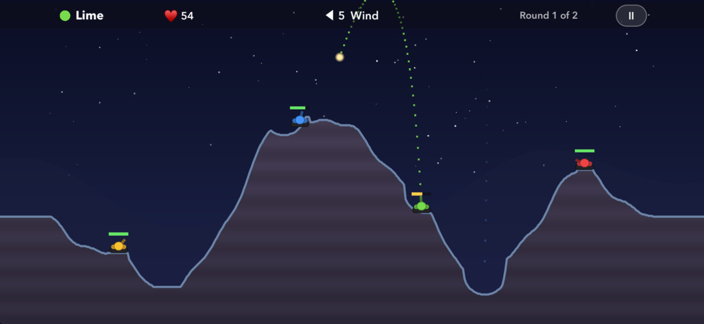

# Ridgefire

An artillery game for iPhone, written in Common Lisp. Tanks sit on hills
that blow apart, and take turns lobbing shells at each other through the
wind. Last tank standing wins the round.

Two to four players, each a person or the computer, in one of two ways:

- **Pass & Play** -- one phone, handed round.
- **Nearby** -- a phone each, in the same room. Phones find each other over
  Bluetooth and peer-to-peer Wi-Fi (Network.framework, over Bonjour), with no internet
  and no server: one phone hosts, the others join.

## Playing

Drag anywhere on the battlefield to aim: sideways turns the barrel, up and
down sets the power. Or use ◀︎ ▶︎ and − + (hold them to keep going). Watch the
wind; it pushes every shell sideways, and shifts a little each turn.

Blasts dig craters and tanks fall into them; a long fall hurts. Damage earns
money, and kills and surviving earn more, to spend in the shop between
rounds:

| Weapon | |
|---|---|
| Pebble | A small shell. You never run out. |
| Boomer | A heavy shell with a wider blast. |
| Splitter | Bursts into five shells at the top of its arc. |
| Roller | Lands, then rolls downhill until it stops. |
| Thunderhead | An enormous blast. Mind your own tank. |
| Mudball | Throws up a hill of earth to hide behind. |
| Spade | Scoops out earth without hurting anyone. |
| Shield | Soaks up 60 damage next round. |

In a Nearby game the host's phone keeps the real game: it plays the computer
tanks, checks every move a guest sends, and sends the game back to everyone.
If a guest drops out, their turns wait half a minute for them and then the
computer plays their tank until they come back -- they find the game listed
as *in progress* and take their tank back. If the host's phone goes away --
out of range, locked, or the app closed -- the guests keep their game and
wait, and rejoin by themselves when the host comes back; a host whose app
was closed finds **Resume** on the title screen. Pass & Play games can be
resumed the same way. Phones stay awake while a game is on.

## Building

The rules (`ridgefire.asd`, `src/core/`) are portable Common Lisp with no
clock and no screen: a shot resolves the whole turn into a list of events for
the app to play back. The app (`ridgefire-app.asd`, `src/ios/`) draws with
SpriteKit through [objc](https://github.com/lispnik/objc), and is built by
[asdf-ios-app](https://github.com/lispnik/asdf-ios-app), which cross-compiles
with ECL. asdf-ios-app is expected beside this checkout (`IOS_APP_DIR`);
everything else comes from [ocicl](https://github.com/ocicl/ocicl).

    make deps        # ocicl install
    make test        # FiveAM suite in SBCL
    make test-ecl    # the same in host ECL, the Lisp the app is built with
    make run-sim     # build, install and launch on the booted simulator
    make demo-sim    # four computer players, playing each other
    make device      # needs IOS_SIGNING_IDENTITY etc. in local.mk
    make testflight  # App Store build, checked and uploaded: doc/testflight.md
    make assets      # redraw the icon and the sounds (python3, no packages)

The tests include whole games played at random with every weapon, checked
after every shot, and a check that the same game and shots always give the
same result -- which is what keeps a Nearby guest in step with its host.

`RIDGEFIRE_SCREEN=setup|nearby|help|battle|shop|results` (as
`SIMCTL_CHILD_RIDGEFIRE_SCREEN`) opens that screen at launch. `host` and
`join` play a Nearby game hands-free between two simulators: launch one of
each. `resume` takes up the saved game, so killing a `host` and relaunching
it with `resume` shows its guests finding it again.

Simulator builds have their own bundle id, `com.burnsidemk.ridgefire.sim`
(`SIM_BUNDLE_ID`). macOS asks once per app whether it may use the local
network, and simulator apps need that for Nearby; if the answer was no,
allow it in System Settings › Privacy & Security › Local Network, or build
with a fresh `SIM_BUNDLE_ID` to be asked again.
